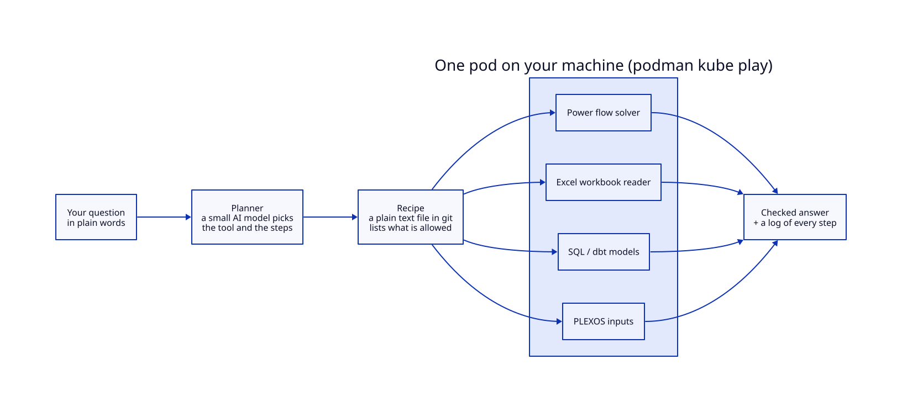

# WattsOn

**Ask a power-system question in plain words. Get an answer you can audit.**

WattsOn is a toolkit for power engineers and system modellers. It takes the routine, repeatable work (run a power flow, pull a
number out of an AEMO workbook, query a model) and turns it into a checked procedure. An AI plans the task. It never does the
maths. Every number comes from a specialist tool running in its own container, and every step is written to a log you can read.

## How it works



- **The AI only plans.** It picks the tool and the order of steps. It does not calculate.
- **Recipes are plain text, kept in git.** A recipe lists exactly what is allowed to run. Review it like any other file.
- **Tools run in containers.** Each one is read-only, has no internet, and logs what it did. That also makes use easy to meter and bill.
- **Answers are re-checked.** A result counts only if re-running the solver reproduces it.

## Try it

You need [Podman](https://podman.io) and [`just`](https://just.systems). Nothing else.

```bash
git clone https://github.com/fungible-farm/wattson && cd wattson
just labs        # three worked examples. No model, no GPU. About a minute.
just excel-read ~/ISP-workbook.xlsm "Approval sheet" A2:A2     # read one cell, with every step logged
```

To run the AI model as well (needs an NVIDIA GPU): `just up granite`, then `just ask "..."`, then `just down`. See [install](docs/install.md).

## Where to go next

| If you want to | Read |
|---|---|
| Set it up | [install](docs/install.md) |
| Read Excel workbooks safely | [Excel reader](docs/excel-mcp.md) |
| See how it is wired together | [interfaces](docs/interfaces.md) and [concepts](docs/concepts.md) |
| Know the limits and how answers are scored | [reference](docs/reference.md) |
| Know what you may reuse | [policy](docs/policy.md) |
| Draw the pod, tools and recipes as diagrams | [diagrams](docs/diagrams/README.md), rendered with our sibling project [kr0ki](https://github.com/promptexecution/kr0ki) (beta) |

**Status:** v0.1.0. The AI models are on Hugging Face under Apache-2.0
([granite](https://huggingface.co/PromptExecutionAU/wattson-granite-4.2-8b-py),
[qwen](https://huggingface.co/PromptExecutionAU/wattson-qwen3.5-4b-pyt)). Measured results: [results](docs/results.md).
Licensed MIT or Apache-2.0, at your option.
